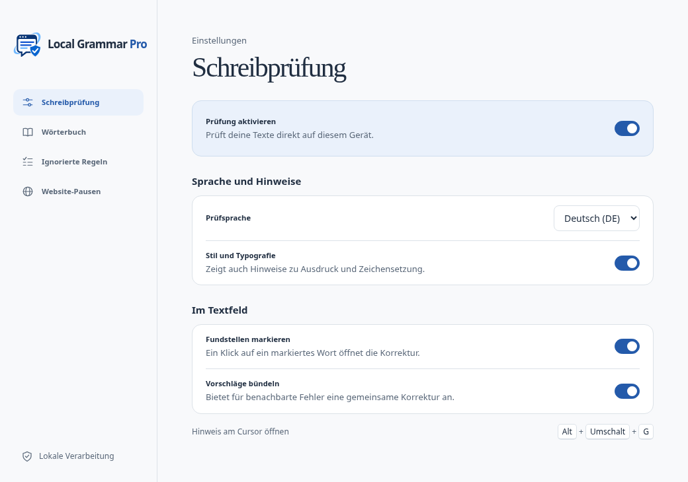
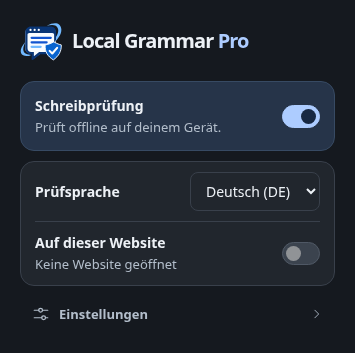

<h1 align="center">Local Grammar Pro</h1>

Rechtschreibung und Grammatik direkt im Browser. Offline auf deinem Gerät. Für Deutsch und Englisch.

<a href="https://github.com/erazer90/Localgrammar/releases/latest">Herunterladen</a> · <a href="PRIVACY.md">Datenschutz</a> · <a href="CONTRIBUTING.md">Entwicklung</a>

## Schreiben mit weniger Unterbrechungen

Markierte Wörter anklicken, Vorschläge ansehen und direkt übernehmen. Benachbarte Fehler lassen sich gemeinsam korrigieren. Rückgängig funktioniert über den Editor.

- Deutsch, US-Englisch und britisches Englisch
- Persönliches Wörterbuch und pausierbare Websites
- Einstellbare Stilhinweise und gebündelte Korrekturen
- Helle und dunkle Oberfläche passend zum System

## Installation

1. Das ZIP aus dem [aktuellen Release](https://github.com/erazer90/Localgrammar/releases/latest) herunterladen und entpacken.
2. In Chrome oder Chromium ab Version 123 unter `chrome://extensions` den **Entwicklermodus** aktivieren.
3. **Entpackte Erweiterung laden** und den Ordner `LocalGrammarPro` auswählen.
4. Offene Webseiten neu laden und losschreiben.

Für ein Update den Inhalt des bisherigen Installationsordners ersetzen und die Erweiterung neu laden. **Alt + Umschalt + G** öffnet einen Hinweis am Cursor, **Esc** schließt ihn.

## Lokale Prüfung

Engine und Sprachpakete sind enthalten. Texte werden auf dem Gerät verarbeitet. Die erste Prüfung benötigt etwas Ladezeit. Pro Prüfung werden bis zu 12.000 Zeichen am Textanfang verarbeitet. Canvas-Editoren wie Google Docs unterstützen keine direkten Inline-Korrekturen.

[Engine und Sprachdaten](engine/vendor/SOURCE.md) · [Lizenzhinweise](LICENSES.md) · [Stand der Weitergaberechte](DISTRIBUTION.md) · [Änderungen](CHANGELOG.md)

## Entwicklung

Node.js 24 verwenden und `npm ci`, `npm run check`, `npm test` sowie `npm run build` ausführen. Browser-Tests und Beiträge beschreibt die [Entwicklungsanleitung](CONTRIBUTING.md).
